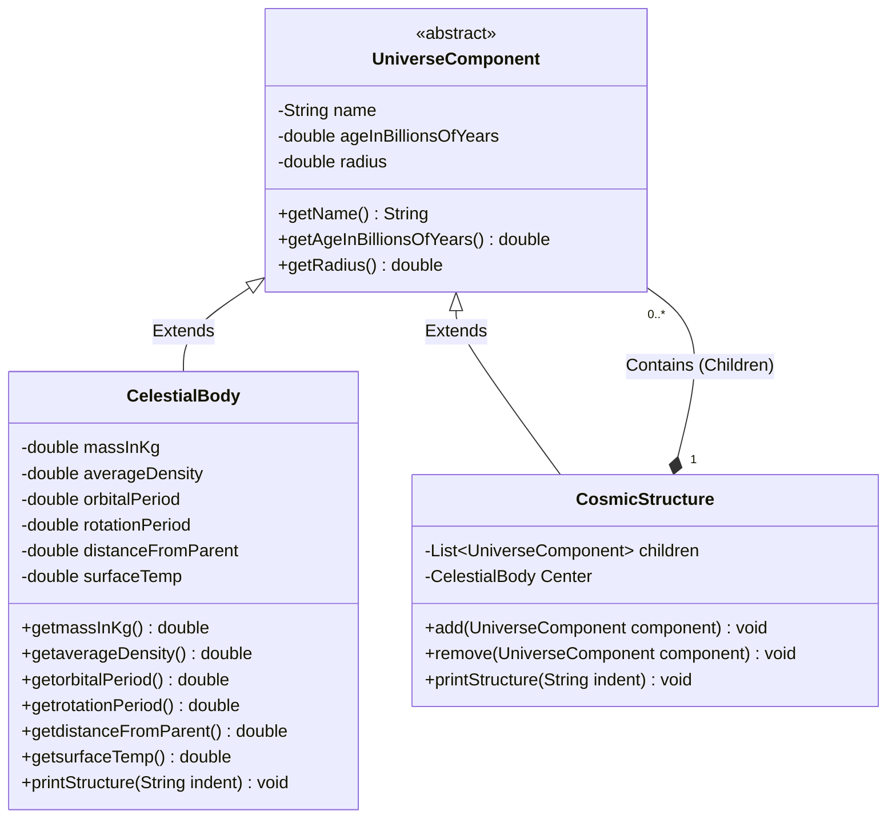

# Celestial OOP Practice System

A modular, object-oriented system designed in Java to model the structures of our universe. This project practices system design architectures, specifically exploring hierarchical structures using a safe, custom structural traversal algorithm.

##  The System Architecture
This project applies the **Composite Design Pattern**, allowing individual celestial entities and entire cosmic collections to share uniform identification tracking.

Here is the exact structural model of the system:



## 🛠️ Compilation & Local Run
To compile and execute the system tracking directly via your terminal, use:

```bash
javac Main.java
java Main
```
